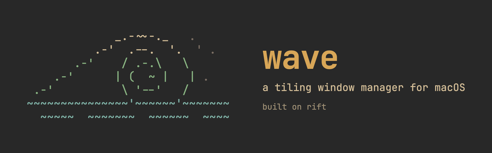

# wave

A tiling window manager for macOS, built on [rift](https://github.com/acsandmann/rift).

wave starts from rift 0.8.3 and keeps everything rift does. It adds smoother animations and a hardened codebase, and its own features come next.

## What it does
- **Many layouts.** Tiling (like i3), binary space partitioning (like bspwm), master-stack (like dwm), scrolling columns (like niri), stacks and floating windows.
- **Smooth motion.** Windows ease into place on the curve you pick, at your slowest display's refresh rate. New windows fly into their tile and closed ones shrink away with their neighbors.
- **No SIP changes.** Works with System Integrity Protection on, and with "Displays have separate Spaces" turned on.
- **Workspaces you can see.** A niri-style overview for dragging windows between workspaces, and trackpad swipes between them like native macOS.
- **Menu bar menu.** Switch workspaces and layouts, and save or restore layouts.
- **Focus follows the mouse,** with auto raise.
- **Live config.** Edit the TOML file and the change applies when you save.
- **Scriptable.** A Mach-port IPC lets other programs (sketchybar and others) query wave and react to its events.

## What's different from rift
- `animation_easing` works: pick any curve listed in `rift.default.toml`, such as `ease_out_cubic`.
- `animation_fps = 0.0` matches your slowest connected display.
- `window_open_close_animation` animates tiled windows opening and closing.
- Panics are replaced with errors and logged fallbacks throughout, so one bad message or missing window can't crash the window manager.
- Every `unsafe` block does one thing and says why it's sound. That work found and fixed several memory bugs.

## Install
wave builds from source for now (macOS only). The programs are still called `rift` and `rift-cli` until the rename lands.

1. `cargo build --release`
2. Copy `rift.default.toml` to `~/.config/rift/config.toml` and edit it to taste.
3. `./target/release/rift-cli service install`, then `./target/release/rift-cli service start`.
4. Give it Accessibility permission when macOS asks. Open and close animations also need Screen Recording.

`rift-cli service restart` picks up a new build.

## Configure
Every setting is in [`rift.default.toml`](rift.default.toml), with a comment explaining it. `rift-cli settings` opens the native Settings window, and rift's [configuration reference](https://acsandmann.github.io/rift-docs/reference/configuration/) covers the rest.

## How it's built
Rust, using macOS's private SkyLight APIs for speed and Core Animation for the overlays.

| Path | What it is |
|---|---|
| `src/bin/rift.rs` | the window manager |
| `src/bin/rift-cli.rs` | the command line: query, execute, subscribe, service |
| `src/actor/` | one thread per job: the reactor (layout decisions), apps, animation, input |
| `src/layout_engine/` | the layouts |
| `src/sys/` | the macOS layer: AX, SkyLight, Mach ports, event taps |
| `src/ui/` | the menu bar, the workspace overview and Settings |
| `crates/rift-client/` | a Rust library for talking to wave over IPC |
| `assets/` | the banner above (`node assets/render.mjs` redraws it) and the app's Info.plist |

## Develop
- `cargo test --workspace` runs the tests.
- Format changed files with nightly rustfmt only: `rustfmt +nightly --edition 2024 <files>`. Stable `cargo fmt` skips the repo's unstable options and reformats everything.

## Credits
wave is a modified version of [rift](https://github.com/acsandmann/rift) by acsandmann, which includes code from glide-wm by tmandry. Licensed under Apache 2.0, the same as rift: see [LICENSE](LICENSE) and [NOTICE](NOTICE).
